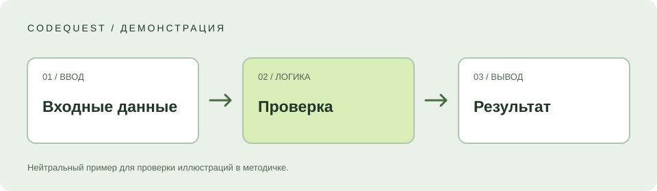
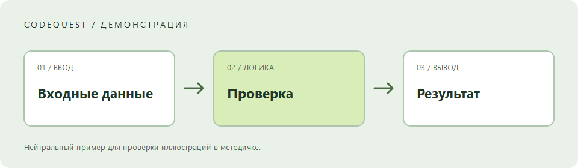
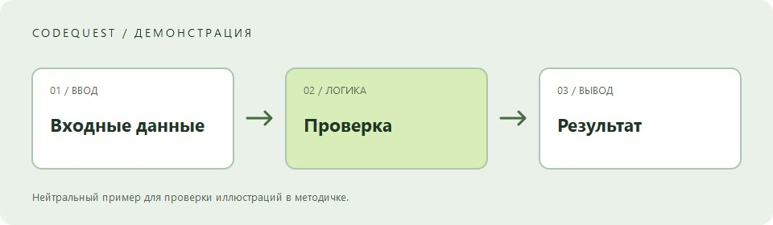
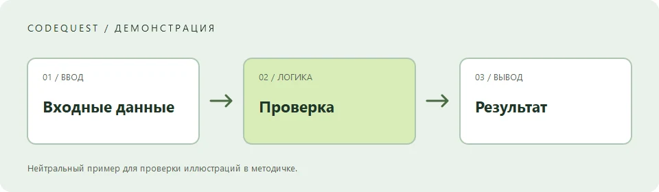

## Что проверяем

Это **демонстрация оформления**, а не занятие из программы. Здесь собраны элементы, которые понадобятся в длинных методичках: объяснения, листинги, таблицы, иллюстрации и задания.

Попробуй переключить тему, скопировать код или открыть страницу на телефоне. Навигация по разделам помогает вернуться к нужному шагу.

> **Идея примера:** программа получает название проекта, убирает лишние пробелы и печатает приветствие. Все данные ниже условные.

## От данных к результату

У программы есть три небольших шага. Их полезно понимать отдельно, прежде чем соединять в одно решение.



| Шаг | Что происходит | Что проверить |
| --- | --- | --- |
| Ввод | Получаем название проекта | Пустая строка допустима как вход |
| Проверка | Убираем пробелы, выбираем запасное имя | Пробелы не становятся названием |
| Результат | Выводим понятное сообщение | В сообщении есть имя проекта |

### Подготовим данные

Короткий фрагмент C# показывает обычную строку. Кнопка копирования появляется над каждым листингом.

```csharp
string projectName = "  Мой проект  ";
Console.WriteLine(projectName.Trim());
```

Текст внутри `Console.WriteLine()` выводится в консоль. Метод `Trim()` убирает пробелы по краям.

### Добавим проверку

```csharp
string GetProjectName(string? input)
{
    string name = input?.Trim() ?? string.Empty;

    if (string.IsNullOrWhiteSpace(name))
    {
        return "Новый проект";
    }

    return name;
}

Console.WriteLine($"Готов к работе: {GetProjectName("  Мой проект  ")}");
```

> **Контрольная точка.** В переданном значении есть пробелы, а в результате по краям имени их нет. Пустой ввод даёт «Новый проект».

## Большой листинг

Длинные строки не сжимают страницу. Листинг прокручивается внутри своего блока, сохраняет отступы и остаётся доступен с клавиатуры. Это особенно важно на телефоне.

```csharp
using System;
using System.Collections.Generic;

namespace CodeQuest.Demo;

public static class Program
{
    public static void Main()
    {
        var examples = new List<string?>
        {
            "  Первый проект  ",
            "",
            null,
            "Каталог",
            "Небольшое приложение с очень длинным названием для проверки горизонтальной прокрутки листинга на мобильном экране"
        };

        foreach (string? example in examples)
        {
            string name = NormalizeName(example);
            PrintSummary(name);
        }
    }

    private static string NormalizeName(string? input)
    {
        string result = input?.Trim() ?? string.Empty;

        if (string.IsNullOrWhiteSpace(result))
        {
            return "Новый проект";
        }

        return result;
    }

    private static void PrintSummary(string name)
    {
        Console.WriteLine(new string('-', 40));
        Console.WriteLine($"Проект: {name}");
        Console.WriteLine($"Символов в названии: {name.Length}");
        Console.WriteLine("Можно переходить к следующему шагу.");
    }
}
```

### Другие языки

Подсветка поддерживает C#, TypeScript, HTML, CSS и команды терминала.

```typescript
interface Project {
  title: string;
  ready: boolean;
}

const project: Project = { title: "Демо", ready: true };
console.log(project.title);
```

```bash
dotnet --version
```

## Иллюстрации и форматы

SVG-схема выше создана специально для демонстрации. Ниже — небольшие тестовые изображения PNG, JPG и WebP. Они проверяют форматы, не изображают реальные учебные проекты. Нажми на рисунок, чтобы рассмотреть его; Escape закрывает просмотр.







## Попробуй самостоятельно

Это короткий список для проверки отображения заданий:

1. Измени название проекта в первом листинге.
2. Передай строку из пробелов и посмотри результат.
3. Вернись к [описанию проверки](#добавим-проверку).

- [x] Пример содержит код с отступами.
- [x] Есть таблица и иллюстрации.
- [ ] Проверь копирование в своём браузере.
- [ ] Посмотри страницу в светлой теме.

Флажки показывают состояние в исходном Markdown; они не сохраняют учебный прогресс.

<details>
<summary>Подсказка к пустому вводу</summary>

Сначала убери пробелы через <code>Trim()</code>, а затем проверь, осталось ли название. Посмотри, какое значение выбирается при пустой строке.

</details>

## Что дальше

В настоящем курсе здесь будут критерии сдачи и переход к следующей опубликованной работе. У этого самостоятельного примера нет соседних занятий — ниже показано соответствующее состояние навигации.

Можно вернуться в [каталог направлений](/#courses) или посмотреть программу [Desktop Forge](/courses/desktop-forge/).
